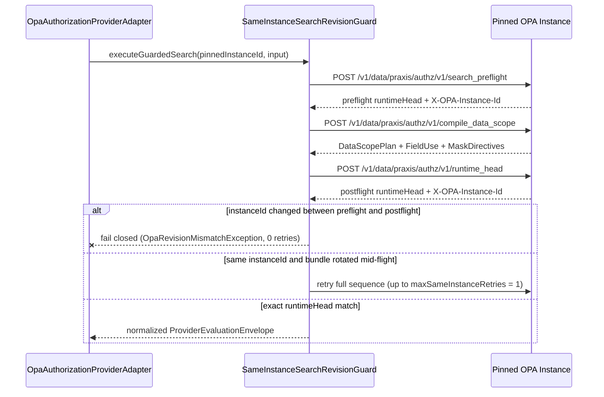

# Praxis Authz OPA

[](https://central.sonatype.com/artifact/io.github.codexrodrigues/praxis-authz-opa)


[](LICENSE)

Deterministic **Open Policy Agent (OPA) Rego v1** compiler, 8-stage bundle assembler, fail-closed `AuthorizationProviderPort` adapter, 3-step `SEARCH` same-instance revision guard, and corpus-verified release coordinator for the **Praxis Authorization Decision Platform**.

**Quick Links:**
[Maven Central](https://central.sonatype.com/artifact/io.github.codexrodrigues/praxis-authz-opa) ·
[Changelog](CHANGELOG.md) ·
[Releasing](RELEASING.md) ·
[Contributing](CONTRIBUTING.md) ·
[Security Policy](SECURITY.md) ·
[Contracts](https://github.com/codexrodrigues/praxis-authz-contracts) ·
[Enforcement Core](https://github.com/codexrodrigues/praxis-authz-enforcement-core) ·
[Spring Boot Starter](https://github.com/codexrodrigues/praxis-authz-starter)

---

## Praxis Decision Platform & Architectural Thesis

The **Praxis Platform** is a **semantically oriented platform for AI-native enterprise applications**, in which **resources, rules, actions, data, and policies are described once** and operated uniformly by **traditional UIs, generative UIs, AI agents, and integrations** — building applications that are legible and operable by AI by design rather than adding AI on the side.

Within the Praxis Decision Platform, OPA policies execute exclusively on the `decisionKind = AUTHORIZATION` plane:

| Plane | Canonical Owner | Responsibilities |
| :--- | :--- | :--- |
| **Resource & Domain Semantics** | [`praxis-metadata-starter`](https://github.com/codexrodrigues/praxis-metadata-starter) | `@ApiResource`, `x-ui`, `/schemas/filtered`, `/schemas/domain`, `@DomainGovernance`, `@DomainLineage`, `@Filterable`, `@WorkflowAction`, `@UiSurface`, stats, and export |
| **Control Plane & Governed Decisions** | [`praxis-config-starter`](https://github.com/codexrodrigues/praxis-config-starter) / [`praxis-config-contracts`](https://github.com/codexrodrigues/praxis-config-contracts) | UI configuration, AI registry, API catalog grounding, maker-checker approvals, and snapshot lifecycle (`/api/praxis/config/**`) |
| **`decisionKind = BUSINESS`** | [`praxis-rules-engine`](https://github.com/codexrodrigues/praxis-rules-engine) | Deterministic 5-state domain invariants, eligibility, and calculations (`RuleSet` / JSON Logic) |
| **`decisionKind = AUTHORIZATION`** | [`contracts`](https://github.com/codexrodrigues/praxis-authz-contracts) -> [`enforcement-core`](https://github.com/codexrodrigues/praxis-authz-enforcement-core) -> **`praxis-authz-opa`** -> [`starter`](https://github.com/codexrodrigues/praxis-authz-starter) | `import rego.v1` compilation, canonical bundle digests, `evaluate_target` / `compile_data_scope`, same-instance revision guarding, and corpus-gated activation |

**Module Boundary Guarantee:** `praxis-authz-opa` depends exclusively on `praxis-authz-contracts`, `praxis-authz-enforcement-core`, and Jackson `2.18.2`. `maven-enforcer-plugin` bans `org.springframework.boot:*` and `org.hibernate.orm:*` (`BND-OWN-004`) so the compiler, bundle assembler, and OPA transport adapters stay embeddable in headless PAP tools, sidecars, and non-Boot runtimes.

---

## Compilation, Bundle Assembly & SEARCH Revision Guard

```mermaid
flowchart LR
    def["AuthorizationPolicyDefinition<br/>(praxis.authorization-policy/v1)"] --> comp["RegoV1PolicyCompiler<br/>import rego.v1 · Stages 1-5"]
    comp --> unit["CompiledRegoUnit<br/>praxis/authz/units/*.rego"]
    unit --> asm["OpaBundleAssembler<br/>combining.rego · Stages 6-8"]
    asm --> bundle["OpaBundleArtifact<br/>bundle.tar.gz bytes + OpaRuntimeRelease"]
    bundle --> coord["GovernedOpaReleaseCoordinator<br/>POLICY_ADMIN_PUBLISH + positive/negative corpus"]
    coord --> transport["OpaClientTransport<br/>HttpClientOpaTransport or DeterministicLocalOpaTransport"]
```



For `EvaluationMode.SEARCH` queries, `SameInstanceSearchRevisionGuard` prevents split-brain bundle drift between preflight revision checks and `DataScopePlan` compilation:



---

## Package & Contract Map

| Package | Key Types | Role |
| :--- | :--- | :--- |
| `org.praxisplatform.authz.opa.compiler` | `RegoV1PolicyCompiler`, `CompiledRegoUnit` | Validates candidate policies (`CC05`), translates fact references to `input.facts["..."].status == "PRESENT"`, emits `import rego.v1` unit modules under `praxis/authz/units/*.rego`, and computes Stages `1–5` of `PolicyDigestChain` |
| `org.praxisplatform.authz.opa.bundle` | `OpaBundleAssembler`, `OpaBundleArtifact`, `OpaBundleDataDocument` | Embeds `praxis/authz/system/combining.rego`, detects competing `policyUnitKey` or `policyId` assignments (`P38`), sorts units canonically, generates `data.json`, and computes `COMPOSITION_DIGEST`, `POLICY_SET_DIGEST`, and `BUNDLE_ARTIFACT_DIGEST` (Stages `6–8`) |
| `org.praxisplatform.authz.opa.revision` | `SameInstanceSearchRevisionGuard`, `OpaRevisionMismatchException`, `OpaEvaluationFailureException` | Executes the 3-step `SEARCH` revision handshake (`P17`), retries bounded same-instance bundle rotations (`0..3`, default `1`), and rejects cross-instance switches immediately without retry |
| `org.praxisplatform.authz.opa.client` | `OpaAuthorizationProviderAdapter`, `OpaClientTransport`, `HttpClientOpaTransport`, `DeterministicLocalOpaTransport`, `OpaTransportResponse` | Implements `AuthorizationProviderPort` (`evaluateTarget`, `evaluateSearch`) against `/v1/data/praxis/authz/v1/{evaluate_target,search_preflight,compile_data_scope,runtime_head}`, enforces request timeouts, and rejects undefined OPA results (`P18`, `P20`) |
| `org.praxisplatform.authz.opa.governance` | `GovernedOpaReleaseCoordinator`, `PolicyCandidateVerificationCorpusCase`, `PolicyCandidateActivationReceipt` | Enforces `POLICY_ADMIN_PUBLISH` (`P28`/`P32`), verifies pinned `definitionFingerprint` (`P55`), executes mandatory positive + negative verification corpus cases against `DeterministicLocalOpaTransport` (`P53`/`P63` anti-`denyAll` gate), and emits signed activation receipts |

---

## Maven Central Coordinates

Requires **Java 21**. Published on Maven Central:

```xml
<dependency>
    <groupId>io.github.codexrodrigues</groupId>
    <artifactId>praxis-authz-opa</artifactId>
    <version>0.1.0-beta.1</version>
</dependency>
```

---

## Usage Examples

### 1. Compile Policies & Assemble a Canonical OPA Bundle

```java
import java.util.List;
import java.util.Map;
import org.praxisplatform.authz.opa.bundle.OpaBundleArtifact;
import org.praxisplatform.authz.opa.bundle.OpaBundleAssembler;
import org.praxisplatform.authz.opa.compiler.CompiledRegoUnit;
import org.praxisplatform.authz.opa.compiler.RegoV1PolicyCompiler;

RegoV1PolicyCompiler compiler = new RegoV1PolicyCompiler();
CompiledRegoUnit unit = compiler.compileUnit(
        policy,
        Map.of(dp.identity().pointKey(), dp),
        Map.of(fc.factContractId(), fc),
        Map.of(qp.projectionId(), qp)
);

OpaBundleAssembler assembler = new OpaBundleAssembler(compiler);
OpaBundleArtifact bundle = assembler.assembleBundle(
        "rel-2026-11-15",
        "rev-2026-11-15-01",
        1L,
        "prod-gov",
        "opa-primary-1",
        opaCapabilitiesDigest,
        List.of(unit)
);
```

### 2. Wire `OpaAuthorizationProviderAdapter` with Local or Sidecar HTTP Transport

```java
import java.net.URI;
import java.time.Duration;
import java.util.Map;
import org.praxisplatform.authz.opa.client.HttpClientOpaTransport;
import org.praxisplatform.authz.opa.client.OpaAuthorizationProviderAdapter;
import org.praxisplatform.authz.opa.revision.SameInstanceSearchRevisionGuard;

HttpClientOpaTransport transport = new HttpClientOpaTransport(
        "opa-primary-1",
        Map.of("opa-primary-1", URI.create("http://127.0.0.1:8181")),
        Duration.ofMillis(1500)
);

OpaAuthorizationProviderAdapter provider =
        new OpaAuthorizationProviderAdapter(transport, new SameInstanceSearchRevisionGuard(1));
```

---

## Security & Fail-Closed Provider Invariants

- **Strict Rego v1 Compilation:** Every compiled policy unit includes `import rego.v1`, enforces `input.facts["..."].status == "PRESENT"` checks (preserving 6-state fact safety), and rejects competing unit or policy identifiers before bundling (`P37`, `P38`).
- **Undefined OPA Result & Timeout Rejection:** Missing `result` fields (`AUTHZ_OPA_UNDEFINED_RESULT`), unknown instance identifiers (`AUTHZ_OPA_UNKNOWN_INSTANCE`), HTTP timeouts (`AUTHZ_OPA_TIMEOUT`), and protocol errors fail closed inside `OpaAuthorizationProviderAdapter` and never degrade to permissive decisions (`P18`, `P20`).
- **Zero Cross-Instance Revision Drift:** During `SEARCH`, `SameInstanceSearchRevisionGuard` requires matching `OpaRuntimeHead` digests on preflight and postflight responses from the **same** `instanceId`. Switching OPA instances mid-search throws `OpaRevisionMismatchException` immediately with zero retries (`P17`).
- **Corpus-Gated Release Activation:** `GovernedOpaReleaseCoordinator` rejects unapproved candidates (`definitionFingerprint` mismatch), zero-test releases, or permissive/`denyAll` degenerate bundles via positive + negative `PolicyCandidateVerificationCorpusCase` verification before issuing a `PolicyCandidateActivationReceipt` (`P53`, `P55`, `P63`).

---

## Build, Verification & Governance

Run the local verification suite (including `maven-enforcer-plugin` runtime boundary checks) with JDK 21 and Maven 3.9+:

```powershell
mvn -B clean verify
```

Related repository documentation:
- [CHANGELOG.md](CHANGELOG.md) — version history and published artifacts
- [RELEASING.md](RELEASING.md) — multi-repository release order and Maven Central publication flow
- [ACTIONS-RELEASE-POLICY.md](ACTIONS-RELEASE-POLICY.md) — GitHub Actions usage and release gate policy
- [CONTRIBUTING.md](CONTRIBUTING.md) — module boundaries, enforcer rules, and contribution workflow
- [SECURITY.md](SECURITY.md) — vulnerability disclosure and fail-closed provider invariants
- [AGENTS.md](AGENTS.md) — coding and governance rules for autonomous agents

## License

Licensed under the [Apache License, Version 2.0](LICENSE).
