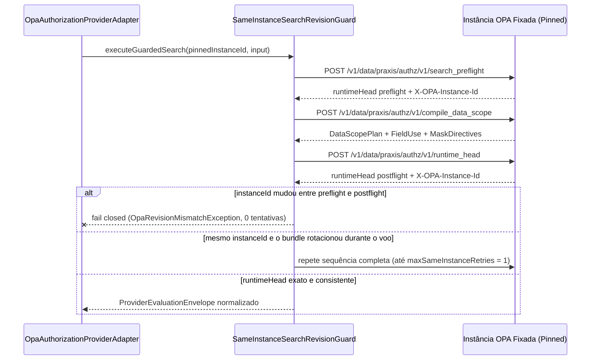

# Praxis Authz OPA

[](https://central.sonatype.com/artifact/io.github.codexrodrigues/praxis-authz-opa)


[](LICENSE)

Compilador determinístico para **Open Policy Agent (OPA) Rego v1** (`import rego.v1`), montador de pacotes (*bundles*) em 8 estágios, adaptador *fail-closed* de `AuthorizationProviderPort`, guarda de consistência de revisão em 3 etapas na mesma instância para buscas `SEARCH` e coordenador de ativação validado por corpus positivo/negativo para a **Praxis Authorization Decision Platform**.

**Links Rápidos:**
[Maven Central](https://central.sonatype.com/artifact/io.github.codexrodrigues/praxis-authz-opa) ·
[Changelog](CHANGELOG.md) ·
[Guia de Release](RELEASING.md) ·
[Como Contribuir](CONTRIBUTING.md) ·
[Política de Segurança](SECURITY.md) ·
[Política de GitHub Actions](ACTIONS-RELEASE-POLICY.md) ·
[Regras para Agentes](AGENTS.md)

**Módulos da Família Authz (`0.1.0-beta.1`):**
[`praxis-authz-contracts`](https://github.com/codexrodrigues/praxis-authz-contracts) ·
[`praxis-authz-enforcement-core`](https://github.com/codexrodrigues/praxis-authz-enforcement-core) ·
**`praxis-authz-opa`** (você está aqui) ·
[`praxis-authz-starter`](https://github.com/codexrodrigues/praxis-authz-starter)

---

## Sumário

1. [Onde Este Módulo Entra na Praxis Platform](#onde-este-m%C3%B3dulo-entra-na-praxis-platform)
2. [Que Problema Corporativo Este Módulo Resolve?](#que-problema-corporativo-este-m%C3%B3dulo-resolve)
3. [Por que a Solução Praxis Está à Frente do Mercado?](#por-que-a-solu%C3%A7%C3%A3o-praxis-est%C3%A1-%C3%A0-frente-do-mercado)
4. [Ganho em Tokens de IA, Contexto e Velocidade em Grandes Sistemas](#ganho-em-tokens-de-ia-contexto-e-velocidade-em-grandes-sistemas)
5. [Compilação Rego v1, Montagem de Bundle e Guarda SEARCH](#compila%C3%A7%C3%A3o-rego-v1-montagem-de-bundle-e-guarda-search)
6. [Mapa de Pacotes e Contratos](#mapa-de-pacotes-e-contratos)
7. [Instalação via Maven Central](#instala%C3%A7%C3%A3o-via-maven-central)
8. [Exemplos Práticos de Uso](#exemplos-pr%C3%A1ticos-de-uso)
9. [Invariantes de Segurança e Fail-Closed no Provedor OPA](#invariantes-de-seguran%C3%A7a-e-fail-closed-no-provedor-opa)
10. [Build, Verificação e Governança](#build-verifica%C3%A7%C3%A3o-e-governan%C3%A7a)

---

## Onde Este Módulo Entra na Praxis Platform

Na [**Praxis Platform**](https://praxisui.dev/), **recursos, regras, ações, dados e políticas são descritos uma vez** e operados de maneira uniforme por interfaces tradicionais, interfaces generativas, agentes de IA e integrações backend. As decisões de autorização OPA executam exclusivamente no plano `decisionKind = AUTHORIZATION`:

| Plano Arquitetural | Dono Canônico | Responsabilidades |
| :--- | :--- | :--- |
| **Semântica de Recursos e Domínio** | [`praxis-metadata-starter`](https://github.com/codexrodrigues/praxis-metadata-starter) | `@ApiResource`, `x-ui`, `/schemas/filtered`, `/schemas/domain`, `@DomainGovernance`, `@DomainLineage`, `@Filterable`, `@WorkflowAction`, `@UiSurface`, estatísticas e exportação |
| **Plano de Controle e Decisões (PAP)** | [`praxis-config-starter`](https://github.com/codexrodrigues/praxis-config-starter) / [`praxis-config-contracts`](https://github.com/codexrodrigues/praxis-config-contracts) | Configuração de UI, registro de IA, catálogo de APIs, aprovações 4-olhos (*maker-checker*) e ciclo de cabeças publicadas (`/api/praxis/config/**`) |
| **Decisões de Negócio (`BUSINESS`)** | [`praxis-rules-engine`](https://github.com/codexrodrigues/praxis-rules-engine) | Motor determinístico de 5 estados em JSON Logic para invariantes de domínio, cálculos e elegibilidade |
| **Estação de Autoria e Simulação** | [`praxis-rules-studio`](https://github.com/codexrodrigues/praxis-rules-studio) | Interface com **Lente de Regras de Negócio** e **Lente de Acesso e Proteção de Dados** para publicar decisões sem editar `.rego` à mão |
| **Autorização e Proteção de Dados (`AUTHORIZATION`)** | [`contracts`](https://github.com/codexrodrigues/praxis-authz-contracts) → [`enforcement-core`](https://github.com/codexrodrigues/praxis-authz-enforcement-core) → **`praxis-authz-opa`** → [`starter`](https://github.com/codexrodrigues/praxis-authz-starter) | Compilação `import rego.v1`, digests canônicos de bundle, `evaluate_target` / `compile_data_scope`, guarda de revisão em `SEARCH` e ativação protegida por corpus |
| **UI & Vitrine Operacional** | [`praxis-ui-angular`](https://github.com/codexrodrigues/praxis-ui-angular) & [`praxis-api-quickstart`](https://github.com/codexrodrigues/praxis-api-quickstart) | Materialização metadata-driven e host operacional completo com PostgreSQL e provas HTTP reais |

**Garantia de Fronteira (`BND-OWN-004`):** `praxis-authz-opa` depende apenas de `praxis-authz-contracts`, `praxis-authz-enforcement-core` e Jackson `2.18.2`. O `maven-enforcer-plugin` proíbe `org.springframework.boot:*` e `org.hibernate.orm:*`, permitindo reutilizar o compilador, o montador de bundles e o transporte HTTP tanto no backend quanto em ferramentas CLI/PAP *headless*.

---

## Que Problema Corporativo Este Módulo Resolve?

Adotar o Open Policy Agent (OPA) em grandes sistemas corporativos traz enorme poder expressivo, mas gera cinco armadilhas críticas quando usado sem camada governada:

1. **Escrita manual propensa a erros em Rego cru:** Desenvolvedores e analistas precisam lembrar de checar nulidades, evitar regras conflitantes (`policyUnitKey`), usar `import rego.v1` e retornar formatos padronizados para acesso, filtro SQL, campos visíveis, máscaras e obrigações.
2. **Degradação silenciosa quando OPA retorna `undefined`:** Em Rego padrão, uma regra cuja condição falha pode simplesmente não produzir campo `result`, fazendo adaptadores ingênuos falharem em parse ou confundirem ausência de regra com permissão.
3. **Condição de corrida (*split-brain*) em consultas `SEARCH` com múltiplos sidecars:** Se o cliente consultar uma instância OPA A para checar revisão/preflight e a requisição de `compile_data_scope` cair na instância OPA B com outro bundle carregado, a busca SQL aplica políticas inconsistentes.
4. **Publicação de políticas degeneradas (`denyAll` ou excessivamente permissivas) em produção:** Um bug de autoria pode bloquear toda a empresa ou liberar todo um módulo no momento da ativação.
5. **Ausência de modo determinístico local em testes e pipelines offline:** Depender de um binário OPA em Docker para todo teste unitário torna o ciclo de engenharia lento em grandes equipes.

`praxis-authz-opa` resolve esses cinco pontos gerando código Rego v1 padronizado a partir da AST governada, empacotando `bundle.tar.gz` com digests verificados, impondo o handshake `SameInstanceSearchRevisionGuard`, validando ativações com `GovernedOpaReleaseCoordinator` e oferecendo o motor `DeterministicLocalOpaTransport` para testes locais rápidos.

---

## Por que a Solução Praxis Está à Frente do Mercado?

| Dimensão | OPA / Rego Escrito à Mão | Frameworks de Autorização Proprietários | **Praxis `praxis-authz-opa`** |
| :--- | :--- | :--- | :--- |
| **Geração Determinística `import rego.v1`** | Rego manual sujeito a estilos divergentes por squad. | DSL proprietária presa ao fornecedor SaaS. | **`RegoV1PolicyCompiler` compila AST estruturada para `import rego.v1` com checagem de fatos `input.facts["..."].status == "PRESENT"` e digests dos Estágios `1–5`.** |
| **Proteção contra Conflito de Unidades** | Sobrescrita silenciosa de pacotes no OPA. | Regras concorrentes resolvidas por ordem frágil. | **`OpaBundleAssembler` embute `praxis/authz/system/combining.rego`, detecta colisões `P38` antes de empacotar e fecha os Estágios `6–8`.** |
| **Consistência em Buscas (`SEARCH`)** | Sidecar load-balanced sem guarda de instância/revisão. | Avaliação remota sem garantia atômica com pushdown SQL. | **`SameInstanceSearchRevisionGuard` fixa a mesma `X-OPA-Instance-Id`, valida `search_preflight` ↔ `compile_data_scope` ↔ `runtime_head` e falha fechado se a instância mudar (`P17`).** |
| **Gate Anti-`denyAll` na Publicação** | Bundle sobe direto se o `.rego` compilar sintaticamente. | Requer suíte externa manual fora do fluxo de ativação. | **`GovernedOpaReleaseCoordinator` exige `POLICY_ADMIN_PUBLISH`, `definitionFingerprint` fixado (`P55`) e aprovação em corpus positivo + negativo (`P53`/`P63`).** |
| **Teste Sem Container vs. Sidecar Real** | Obrigatório subir binário OPA ou mockar HTTP manualmente. | Só funciona contra o serviço hospedado do fornecedor. | **`DeterministicLocalOpaTransport` espelha localmente o comportamento OPA com injeção determinística de falhas, trocando com `HttpClientOpaTransport` via uma única porta.** |

---

## Ganho em Tokens de IA, Contexto e Velocidade em Grandes Sistemas

Ao escalar o uso de IA e times paralelos em aplicações corporativas com dezenas de módulos:

- **Eliminação de Rego Boilerplate no Contexto da LLM:** Em vez de pedir para uma IA escrever e depurar centenas de linhas `.rego` repetitivas para extração de `DataScope`, checagem de 6 estados de fato e combinação de máscaras em cada entidade, a IA atua sobre a definição declarativa (`AuthorizationPolicyDefinition` / `AuthzHostPolicyBootstrapBuilder`), enquanto `RegoV1PolicyCompiler` e `OpaBundleAssembler` geram todo o `import rego.v1` + `combining.rego` deterministicamente.
- **Ciclo de Feedback em Milissegundos via `DeterministicLocalOpaTransport`:** Agentes de desenvolvimento e desenvolvedores testam cenários completos de compilação, colisão, rotação de revisão e corpus positivo/negativo em memória via `mvn verify`, sem precisar levantar sidecars OPA ou containers Docker a cada mudança.
- **Publicação Segura Sem Intervenção Humana Arriscada:** Com o gate de corpus positivo + negativo embutido no `GovernedOpaReleaseCoordinator`, erros gerados por humanos ou por assistentes de IA são interceptados automaticamente antes de gerar um `PolicyCandidateActivationReceipt` em produção.

---

## Compilação Rego v1, Montagem de Bundle e Guarda SEARCH

```mermaid
flowchart LR
    def["AuthorizationPolicyDefinition<br/>(praxis.authorization-policy/v1)"] --> comp["RegoV1PolicyCompiler<br/>import rego.v1 · Estágios 1-5"]
    comp --> unit["CompiledRegoUnit<br/>praxis/authz/units/*.rego"]
    unit --> asm["OpaBundleAssembler<br/>combining.rego · Estágios 6-8"]
    asm --> bundle["OpaBundleArtifact<br/>bundle.tar.gz bytes + OpaRuntimeRelease"]
    bundle --> coord["GovernedOpaReleaseCoordinator<br/>POLICY_ADMIN_PUBLISH + corpus positivo/negativo"]
    coord --> transport["OpaClientTransport<br/>HttpClientOpaTransport ou DeterministicLocalOpaTransport"]
```



Para consultas `EvaluationMode.SEARCH`, `SameInstanceSearchRevisionGuard` impede deriva entre a verificação de revisão e a compilação de `DataScopePlan`:



---

## Mapa de Pacotes e Contratos

| Pacote (`org.praxisplatform.authz.opa...`) | Tipos Principais | Papel na Arquitetura |
| :--- | :--- | :--- |
| `...compiler` | `RegoV1PolicyCompiler`, `CompiledRegoUnit` | Valida políticas candidatas (`CC05`), traduz referências de fatos para `input.facts["..."].status == "PRESENT"`, emite unidades `import rego.v1` em `praxis/authz/units/*.rego` e calcula os Estágios `1–5` de `PolicyDigestChain` |
| `...bundle` | `OpaBundleAssembler`, `OpaBundleArtifact`, `OpaBundleDataDocument` | Embute `praxis/authz/system/combining.rego`, detecta atribuições concorrentes de `policyUnitKey` ou `policyId` (`P38`), ordena unidades canonicamente, gera `data.json` e calcula `COMPOSITION_DIGEST`, `POLICY_SET_DIGEST` e `BUNDLE_ARTIFACT_DIGEST` (Estágios `6–8`) |
| `...revision` | `SameInstanceSearchRevisionGuard`, `OpaRevisionMismatchException`, `OpaEvaluationFailureException` | Executa o handshake de revisão em 3 etapas para `SEARCH` (`P17`), aplica retentativas limitadas na mesma instância em rotações benignas (`0..3`, padrão `1`) e rejeita troca de instância imediatamente sem retry |
| `...client` | `OpaAuthorizationProviderAdapter`, `OpaClientTransport`, `HttpClientOpaTransport`, `DeterministicLocalOpaTransport`, `OpaTransportResponse` | Implementa `AuthorizationProviderPort` (`evaluateTarget`, `evaluateSearch`) contra `/v1/data/praxis/authz/v1/{evaluate_target,search_preflight,compile_data_scope,runtime_head}`, impõe timeouts por requisição e rejeita respostas `undefined` do OPA (`P18`, `P20`) |
| `...governance` | `GovernedOpaReleaseCoordinator`, `PolicyCandidateVerificationCorpusCase`, `PolicyCandidateActivationReceipt` | Impõe autoridade `POLICY_ADMIN_PUBLISH` (`P28`/`P32`), verifica `definitionFingerprint` fixado (`P55`), executa corpus obrigatório positivo + negativo sobre `DeterministicLocalOpaTransport` (gate anti-`denyAll` `P53`/`P63`) e emite recibos assinados de ativação |

---

## Instalação via Maven Central

Requer **Java 21**. Publicado no Maven Central:

```xml
<dependency>
    <groupId>io.github.codexrodrigues</groupId>
    <artifactId>praxis-authz-opa</artifactId>
    <version>0.1.0-beta.1</version>
</dependency>
```

---

## Exemplos Práticos de Uso

### 1. Compilar Políticas e Montar um Bundle OPA Canônico

```java
import java.util.List;
import java.util.Map;
import org.praxisplatform.authz.opa.bundle.OpaBundleArtifact;
import org.praxisplatform.authz.opa.bundle.OpaBundleAssembler;
import org.praxisplatform.authz.opa.compiler.CompiledRegoUnit;
import org.praxisplatform.authz.opa.compiler.RegoV1PolicyCompiler;

RegoV1PolicyCompiler compiler = new RegoV1PolicyCompiler();
CompiledRegoUnit unit = compiler.compileUnit(
        policy,
        Map.of(dp.identity().pointKey(), dp),
        Map.of(fc.factContractId(), fc),
        Map.of(qp.projectionId(), qp)
);

OpaBundleAssembler assembler = new OpaBundleAssembler(compiler);
OpaBundleArtifact bundle = assembler.assembleBundle(
        "rel-2026-11-15",
        "rev-2026-11-15-01",
        1L,
        "prod-gov",
        "opa-primary-1",
        opaCapabilitiesDigest,
        List.of(unit)
);
```

### 2. Conectar `OpaAuthorizationProviderAdapter` via HTTP Sidecar (ou Transporte Local)

```java
import java.net.URI;
import java.time.Duration;
import java.util.Map;
import org.praxisplatform.authz.opa.client.HttpClientOpaTransport;
import org.praxisplatform.authz.opa.client.OpaAuthorizationProviderAdapter;
import org.praxisplatform.authz.opa.revision.SameInstanceSearchRevisionGuard;

HttpClientOpaTransport transport = new HttpClientOpaTransport(
        "opa-primary-1",
        Map.of("opa-primary-1", URI.create("http://127.0.0.1:8181")),
        Duration.ofMillis(1500)
);

OpaAuthorizationProviderAdapter provider =
        new OpaAuthorizationProviderAdapter(transport, new SameInstanceSearchRevisionGuard(1));
```

---

## Invariantes de Segurança e Fail-Closed no Provedor OPA

- **Compilação Rego v1 Estrita:** Toda unidade compilada traz `import rego.v1`, obriga checagem `input.facts["..."].status == "PRESENT"` (preservando os 6 estados de fato) e rejeita identificadores conflitantes antes do empacotamento (`P37`, `P38`).
- **Rejeição de `undefined` e Timeouts do OPA:** Ausência de campo `result` (`AUTHZ_OPA_UNDEFINED_RESULT`), instância desconhecida (`AUTHZ_OPA_UNKNOWN_INSTANCE`), timeout HTTP (`AUTHZ_OPA_TIMEOUT`) e erros de protocolo falham fechado dentro de `OpaAuthorizationProviderAdapter` sem nunca degradar para decisão permissiva (`P18`, `P20`).
- **Zero Deriva Entre Instâncias em `SEARCH`:** Em consultas `SEARCH`, `SameInstanceSearchRevisionGuard` exige correspondência exata do digest `OpaRuntimeHead` entre preflight e postflight na **mesma** `instanceId`. Troca de instância OPA no meio da consulta lança `OpaRevisionMismatchException` imediatamente sem retry (`P17`).
- **Ativação Protegida por Corpus:** `GovernedOpaReleaseCoordinator` bloqueia candidatos não aprovados (divergência de `definitionFingerprint`), releases sem casos de teste ou bundles degenerados (`denyAll` / excessivamente permissivos) via verificação obrigatória positiva + negativa de `PolicyCandidateVerificationCorpusCase` antes de emitir `PolicyCandidateActivationReceipt` (`P53`, `P55`, `P63`).

---

## Build, Verificação e Governança

Execute a suíte de verificação local (incluindo checagens de fronteira do `maven-enforcer-plugin`) com JDK 21 e Maven 3.9+:

```powershell
mvn -B clean verify
```

Documentação relacionada neste repositório:
- [CHANGELOG.md](CHANGELOG.md) — histórico de versões e artefatos publicados
- [RELEASING.md](RELEASING.md) — ordem de release multi-repositório e fluxo Maven Central
- [ACTIONS-RELEASE-POLICY.md](ACTIONS-RELEASE-POLICY.md) — política estrita de uso do GitHub Actions e gates de release
- [CONTRIBUTING.md](CONTRIBUTING.md) — fronteiras de módulo, regras do Enforcer e fluxo de contribuição
- [SECURITY.md](SECURITY.md) — divulgação responsável de vulnerabilidades e invariantes de segurança
- [AGENTS.md](AGENTS.md) — regras de engenharia e governança para agentes autônomos

## Licença

Distribuído sob a licença [Apache License, Version 2.0](LICENSE).
